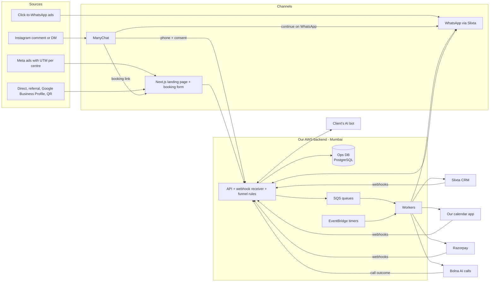
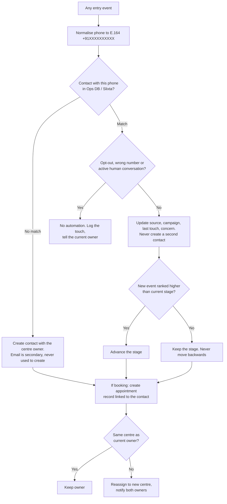
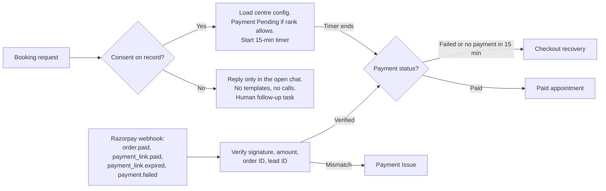

# SSW Paid Appointment Funnel — Project Plan

> **Update 24 Nov 2026: Slixta integration narrowed.** The landing page now sends Slixta three things only: the lead, CHECKOUT ABANDONED and APPOINTMENT BOOKED. WhatsApp messages, reminders, checkout recovery, telecaller tasks, no-show follow-up, reschedules, cancellations and Nurture all run as Slixta workflows, and Slixta sends nothing back. Where this plan says our backend does those things, or that Slixta calls us, docs/02 now applies. The WhatsApp AI bot, ManyChat and Bolna (phase 2) need a fresh design with Slixta.

_Last updated: 13 Nov 2026 · Sources: `SSW_Ahmedabad_NadiPariksha_MASTER.html` (mock-up v1) and the Figma board "Sri Sri Wellness — Paid Appointment Funnel v5" (all 14 sections reviewed)_

## In one paragraph

We are building a custom funnel on AWS that takes leads from Meta ads, Google, QR codes, WhatsApp and Instagram. It books them into a paid ₹500 consultation and keeps chasing everyone who has not paid. Our own backend and **Ops DB** are the source of truth for every lead, payment, message and call. **Slixta** is where the sales and centre teams work: contacts, stages, telecaller tasks, segments and campaigns. Our own calendar app replaces Cal.com for slots. The landing pages are Next.js for speed. No third-party automation tool sits in the middle; all funnel rules live in our backend.

---

## 1. The system at a glance



The board's 14 sections map onto the build like this:

| Board section | What it means for the build | Phase |
| --- | --- | --- |
| 1. Lead generation | UTM per centre on every ad link; QR codes carry `utm_source=qr` | 1 |
| 2A. Landing page path | Next.js centre pages + booking form + Razorpay Checkout | 1 |
| 2B. WhatsApp path | WhatsApp webhook, flags check, hand-off to the client's AI bot, bot tools API, payment links | 2 |
| 2C. Instagram DM path | ManyChat sends phone + consent to our API; personal booking link; continue on WhatsApp | 2 |
| 3. Duplicate and existing lead rules | Phone is the identity, stage ranking, owner by centre, flags | 1 |
| 4. Orchestration and payment check | Consent gate, 15-min timer, Razorpay webhooks with full verification | 1 |
| 5. Checkout recovery | WhatsApp templates at 0 h, 2 h, 24 h, 48 h, then Closed + Nurture | 1 |
| 6. Paid appointment | Booking confirmed in calendar, receipt on WhatsApp, centre notified, reminders scheduled | 1 |
| 7. Slots | Our calendar replaces Cal.com (see [03-calendar-integration.md](03-calendar-integration.md)) | 1 |
| 8. Reminders and AI calls | WhatsApp reminders + Bolna AI calls (Sarvam voices), outcomes to Slixta | 2 |
| 9. Human telecalling | Telecaller tasks in Slixta; automation pauses while a human is talking | 1 (tasks), 2 (pause from chat) |
| 10. Centre visit and conversion | Staff mark Visited / No Show / Enrolled in Slixta; follow-up journeys | 2 |
| 11. No-refund and settlement | Payment Issue cases, settlement log, daily and weekly reconciliation | 1 (cases), 3 (full recon) |
| 12. Tracking and controls | Event log, queue retries, daily reconciliation, dashboard | 1 (log), 3 (dashboard) |
| 13. Nurture and campaigns | Slixta segment + approved WhatsApp marketing templates, Stop = opt-out | 3 |
| 14. Deployment | Client's AWS account, Mumbai (see [04-deployment-vercel-aws.md](04-deployment-vercel-aws.md)) | 1 |

---

## 2. Landing page path (board 2A)

### Pages

One template, one page per **centre × programme**, so every Meta ad has its own UTM-tagged URL: `/ahmedabad/joints`, `/ahmedabad/sleep`, `/ahmedabad/women`. More centres are new content files.

The board lists what each centre page must carry. The mock-up has most of it; the gaps are marked.

| Board requirement | In the mock-up? | Build note |
| --- | --- | --- |
| Programme | Yes (3 variants: joints, sleep, women) | Content file per programme |
| Practitioner | **No** | New section: doctor photo, name, qualifications, languages |
| Proof | **No** (only "Why guests choose") | New section: testimonials / ratings / centre photos |
| FAQs | Yes | Shared + per-programme FAQ |
| No-refund policy | Yes, but wording differs from the board (see open questions) | Shown near the pay button and in the form |
| Book Appointment | Yes | Scrolls to the booking card |
| Chat on WhatsApp | Yes ("Ask on WhatsApp") | `wa.me` link with a prefilled message that carries the centre and programme, so the bot knows the context |

### Booking form

The board's short form asks for **name, phone, concern, language, centre, slot**, plus a consent tick for WhatsApp and calls, with the no-refund policy shown. The mock-up splits this into 3 steps. We keep the 3 steps because they already handle the edge cases. The centre and concern come from the page, so the visitor never types them.

| Step | Fields | What the backend does |
| --- | --- | --- |
| 1. Your details | Who it is for, name, their name, 18+, mobile, email (optional), language, consent tick | Duplicate check (board 3), save contact as **Enquiry** in Slixta, store consent with proof |
| 2. Day and time | Live slots from our calendar | Hold slot for 15 min, create Razorpay order tagged with lead ID + centre ID + appointment ID, stage **Payment Pending**, start 15-min timer |
| 3. Pay | Terms + no-refund tick, optional marketing opt-in | Open Razorpay Checkout with name and phone prefilled |

Saving at step 1 means everyone who gives a phone number and consent can be recovered. The board's "form not submitted" branch still applies to visitors who leave before step 1: they go to Meta retargeting only (Pixel + Conversions API).

Personal booking links (from ManyChat, recovery messages and telecallers) open the same page with step 1 prefilled from a signed token: `/ahmedabad/joints?t=<signed-token>`.

### Screens (from the mock-up)

Details · Day and time · Pay · Confirming payment · Taking longer · Booked · Payment failed · Hold ended · Hold ended after payment started. Booking reference format: `AHM-123456` (centre code + 6 digits).

---

## 3. WhatsApp path (board 2B)

**Decided (13 Nov 2026): the brand's WhatsApp number is connected inside Slixta.** Slixta forwards every inbound WhatsApp message to our backend by webhook, and we send every outbound message (bot replies, templates) through Slixta's API. Telecallers chat from Slixta as usual. The contract is in [02-slixta-crm-api-requirements.md](02-slixta-crm-api-requirements.md#whatsapp-through-slixta).

Every inbound message is handled by our backend:

1. Normalise the phone and run the duplicate check (board 3).
2. Check flags: opt-out, wrong number, **active human conversation**. If a flag is set, the bot does not reply; the touch is logged and the owner is told.
3. Otherwise pass the message, with contact context, to the **client's AI bot**. The bot says it is automated and answers from the centre knowledge base, no menus.
4. The bot calls our **Bot Tools API** to act (contract in [05-channel-integrations.md](05-channel-integrations.md)):
   - `record_consent`: consent text, time, source
   - `get_slots`: live slots for a centre
   - `hold_and_pay`: hold the slot 15 min and get a Razorpay **payment link** that expires in 15 min (the no-refund policy is stated first)
   - `save_enquiry`: "only asking for now" → consent for follow-up → Enquiry in Slixta + Nurture segment
   - `handoff_to_human`: clinical question, complaint or asks for a person → telecaller task in Slixta
5. Bot replies go out through our backend, so every message is logged in the Ops DB and flags are always enforced.

Click-to-WhatsApp ads land here. The ad referral data (`ctwa_clid`, ad ID) from the WhatsApp webhook is stored as the lead's attribution.

---

## 4. Instagram DM path (board 2C)

ManyChat runs the DM and answers basic questions. Then:

- It asks for phone and consent. **No phone means no Slixta record**: the person stays in Instagram DM and Meta retargeting only.
- With phone + consent, ManyChat calls our API. We run the duplicate check and save the contact as **Enquiry, source Instagram DM**.
- Our API returns two things ManyChat shows as buttons:
  - **Booking link**: personal link, page opens with details prefilled (goes to 2A).
  - **Continue on WhatsApp**: `wa.me` link with a prefilled message (goes to 2B).

---

## 5. Lead rules (board 3)

Every entry event (form, WhatsApp, Instagram DM, Razorpay, calendar, call) goes through the same rules engine in our backend.



### Stage ranking (high to low, from the board)

| Rank | Contact stage |
| --- | --- |
| 8 | Enrolled |
| 7 | Visited |
| 6 | Confirmed or Paid |
| 5 | Payment Pending |
| 4 | Checkout Abandoned or Payment Failed |
| 3 | Cancelled or No Show |
| 2 | Enquiry |
| 1 | Closed (Not Converted) |

We keep two separate things:

- **Contact stage** (in Slixta): follows the rank rule for entry events and never moves backwards on its own.
- **Appointment status** (per booking): always reflects the facts — held, payment pending, paid, confirmed, rescheduled, cancelled, no show, visited, payment issue.

A few board rules need an explicit exception to the rank rule, listed in the open questions (for example "recovery ended → Closed" and "Paid → No Show" both move down).

Weekly hygiene report: contacts sharing a phone or email, for a manual merge where the older record is the master.

---

## 6. Payment check and orchestration (board 4)



Rules:

- The browser never confirms a payment. Only a verified Razorpay webhook (or a server-side signature check of the Checkout response) moves an appointment to Paid.
- The 15-minute timer is server side (EventBridge Scheduler on AWS). The countdown on screen is display only.
- If payment arrives after the hold expired: book it if the slot is still free; otherwise open a Payment Issue (board 11).

---

## 7. After payment (board 6)

1. Appointment status **Paid**; store payment ID, amount and time.
2. Convert the hold to a booking in our calendar (the event appears in the practitioner's calendar).
3. WhatsApp confirmation: receipt, date and time, address, map, checklist, no-refund note, reception number.
4. Notify the centre team.
5. If the receipt is **not delivered** on WhatsApp (delivery status webhook), the number may be wrong → telecaller task.
6. Schedule reminders and AI calls (board 8). No call right after payment.

---

## 8. Not paid: checkout recovery (board 5)

Only for leads with consent on record.

| When | Action |
| --- | --- |
| Payment failed, or no payment within 15 min | Stage Checkout Abandoned / Payment Failed. Release the slot hold |
| Immediately | WhatsApp template with a **Resume Payment** button |
| +2 hours | Short consultation explainer |
| +24 hours | Practitioner or centre trust asset + FAQs |
| +48 hours | Final reminder with **Talk to an Advisor** |
| Resumes payment | Recheck the slot, create a new Razorpay order or payment link, back to the payment check |
| Replies with a question | Goes to the AI bot |
| Asks for an advisor | Telecaller task |
| No action after 48 h | Stop recovery, stage Closed (Not Converted), add to Nurture segment, keep in Meta retargeting |

Any later payment or booking cancels the pending recovery steps.

---

## 9. Reminders and AI calls (board 8)

| When | Channel | Detail |
| --- | --- | --- |
| 24 h before | WhatsApp | Reminder with **Confirm** button + reception number for changes |
| 24 h before | Bolna AI call 1 | Inside calling hours. Skipped if booked less than 24 h ahead |
| Day of visit | WhatsApp | Map and arrival instructions |
| Day of visit, 8 am or 4 h before, whichever is later | Bolna AI call 2 | |

Call outcomes:

| Outcome | Action |
| --- | --- |
| Answered, confirmed | Appointment status Confirmed |
| No answer or busy | One retry after 30 min + WhatsApp prompt; still unreachable → telecaller task |
| Wants to change or cancel | Give reception number, explain no refund, flag to reception |
| Human needed (clinical, complaint, payment issue, low confidence, asks for a person) | Telecaller task |
| Wrong number or opt-out | Stop automation, set flag in Slixta |

Every outcome, summary and recording link goes to our backend and is written to Slixta. A reschedule from reception (calendar webhook) restarts the reminders and calls.

---

## 10. People in the loop (boards 9, 10, 11)

- **Telecaller task** (Slixta): created for the correct centre telecaller with full context. While a telecaller is calling or chatting from Slixta, the AI bot and automation pause for that contact. Dispositions: confirmed, change sent to reception, unreachable, clinical escalation, payment issue. "Not ready" or "unreachable" goes to Nurture.
- **Centre visit**: staff mark **Visited** in Slixta. No Show gets a kind WhatsApp message with the reception number plus a telecaller follow-up; the fee is not refunded. **Enrolled** records programme and revenue and starts onboarding, feedback and retention. Not enrolled gets the explainer, proof, FAQs and an advisor callback.
- **Payment Issue** (Ops DB): opened on a webhook mismatch, a reconciliation gap or a customer complaint. Automation pauses and the operations owner is alerted.

| What went wrong | Resolution |
| --- | --- |
| Paid, booking missing, slot still free | Book the slot, send the receipt, resume the normal flow |
| Paid, but the slot is gone | Telecaller offers nearest free slots; if none suits, technical reversal |
| Charged twice | Reverse the extra payment |
| Debited at bank, failed at Razorpay | Tell the customer the bank reverses it automatically |
| Customer changed their mind | No refund; customer calls reception to change the slot |

A technical reversal through Razorpay, approved by the operations owner, is the only case where money goes back. Every outcome is recorded in the settlement log and on the contact in Slixta, then matched against the Razorpay settlement report with weekly sign-off by accounts.

---

## 11. Nurture and campaigns (board 13)

- Enter the **Nurture** segment in Slixta when: only asking for now, recovery ended with no action, or not ready after a telecaller follow-up.
- Only contacts with **promotional consent** and no opt-out, wrong number or active booking get campaigns. Everyone else stays in Meta retargeting only.
- The client team builds the campaign in Slixta by centre, concern and language and schedules an approved WhatsApp marketing template with **Book Now** and **Stop** buttons. There is a limit on messages per contact, and every send is logged in the Ops DB.
- **Stop** sets the opt-out flag. **Book Now** or a reply saves the campaign as the source and continues with the AI bot. No response stays in Nurture.

---

## 12. Tracking and controls (board 12)

- **Ops DB event log**: every lead, payment, message and call event, append-only.
- **Ops DB is the source of truth.** Changes go to Slixta through a queue and are retried if Slixta is down.
- **Job failures**: retry with backoff from the queue, then a dead-letter queue and an alert to operations.
- **Daily reconciliation**: Razorpay vs Ops DB vs Slixta vs calendar vs WhatsApp vs AI calls. A gap opens a Payment Issue.
- **Dashboard**: by centre, source, channel and funnel stage.
- **Ad tracking**: Meta Pixel + Conversions API (server side) for Lead, InitiateCheckout and Purchase, de-duplicated by event ID; GA4 for site analytics.

---

## 13. Architecture

### Decided (13 Nov 2026): one TypeScript codebase, two runtime roles

```
ssw-funnel/
  apps/
    web/            Next.js: centre landing pages, booking UI, API routes, webhooks, internal ops pages
    worker/         Node worker: consumes SQS, runs timers, Slixta sync, WhatsApp sends, Bolna calls, reconciliation
  packages/
    core/           Funnel rules: lead rules, stage ranking, consent gate, payment verification, recovery and reminder schedules
    db/             Drizzle schema + migrations for the Ops DB (PostgreSQL)
    integrations/   Typed clients: Slixta, calendar, Razorpay, WhatsApp Cloud API, AI bot, ManyChat, Bolna, Meta CAPI
    content/        Centre and programme content files
```

- On **AWS** (board 14): the web app and the worker run as two ECS Fargate services from the same Docker image. CloudFront sits in front: centre pages are pre-rendered and cached at the edge, static assets come from S3 / the CDN. RDS PostgreSQL, SQS with a dead-letter queue, EventBridge Scheduler, Secrets Manager, CloudWatch.
- On the **Vercel demo**: the web app runs on Vercel; the worker's jobs run from a per-minute cron route against a jobs table in Postgres instead of SQS / EventBridge. Same code, different queue adapter.

Why not split the landing page (S3) from the backend as the board draws it: the booking form needs server routes for every step, and Next.js already pre-renders the pages, so CloudFront serves them as fast as S3 would. One image, one deploy pipeline. The board's alternative (static export to S3 + separate API service) remains possible if the client insists.

### Stack

| Layer | Choice |
| --- | --- |
| Language | TypeScript everywhere |
| Web | Next.js (current stable), App Router, plain CSS ported from the mock-up's design tokens, `next/font`, `next/image` |
| Validation | Zod schemas shared by browser, API and worker |
| Database | PostgreSQL + Drizzle ORM |
| Queue / timers | SQS + EventBridge Scheduler on AWS; Postgres jobs table + cron on the demo |
| Payments | Razorpay Orders (web) + Payment Links (WhatsApp) + webhooks |
| Messaging | WhatsApp through Slixta's WhatsApp integration (inbound by Slixta webhook, outbound by Slixta API) |
| Calls | Bolna AI (Sarvam voices) |
| Tests | Vitest (rules, verification), Playwright (booking screens) |

### Ops DB tables

| Table | Holds |
| --- | --- |
| `centres` | Code, name, address, map link, reception number, Slixta owner and telecaller IDs, calling hours, fee, calendar IDs, languages |
| `contacts` | Phone (E.164), name, email, language, concern, centre, stage + rank, flags (opt-out, wrong number, human active), Slixta contact ID, first and last touch attribution |
| `consents` | Contact, type (booking contact, terms/no-refund, promotional), granted, wording version, source, time, IP |
| `appointments` | Ref, contact, patient details, centre, slot, calendar hold/booking IDs, status, payment link |
| `payments` | Razorpay order / payment link / payment IDs, amount, status, verification result |
| `payment_issues` | Type, status, resolution, approvals |
| `settlement_log` | Every money outcome, matched to Razorpay settlements |
| `messages` | Every WhatsApp message in and out, template, delivery status |
| `calls` | Every Bolna call: schedule, outcome, summary, recording URL |
| `tasks` | Telecaller tasks mirrored from Slixta |
| `schedules` | Pending timers: payment timeout, recovery steps, reminders, calls |
| `events` | Append-only event log of everything |
| `outbox` | Pending Slixta / external writes with attempts and next retry |

### Speed targets for the landing pages

- Largest Contentful Paint under 2.0 s on a mid-range Android over 4G
- Under 80 KB of JavaScript on first load; the booking form hydrates as an island
- Lighthouse performance 95+; no layout shift from fonts or images
- Slots prefetched while the visitor fills step 1

---

## 14. Delivery phases

| Phase | Scope | Needs from others |
| --- | --- | --- |
| 1. Web funnel | Monorepo, Ops DB, centre pages, booking form, lead rules, Slixta sync, calendar holds and bookings, Razorpay Checkout + webhooks, confirmation + recovery WhatsApp templates, telecaller tasks, Payment Issues, event log, Vercel demo | Slixta endpoints (doc 02), calendar endpoints (doc 03), Razorpay account, WhatsApp provider + approved templates |
| 2. Conversational channels | WhatsApp webhook + AI bot hand-off + Bot Tools API, payment links, ManyChat integration, Bolna reminder calls, human-active pause, Visited / No Show / Enrolled journeys | Client's AI bot endpoint, ManyChat Pro account, Bolna account + agent |
| 3. Controls and growth | Daily reconciliation, settlement matching, dashboard, weekly hygiene report, Nurture campaigns and Stop handling, AWS production cut-over | Razorpay settlement access, Slixta campaigns |

**Decided (13 Nov 2026): build phase 1 first.** It starts against mock Slixta / calendar adapters while the partner endpoints are built.

### Refund policy (decided 13 Nov 2026: the Figma rule)

Page copy: "The ₹500 consultation fee is non-refundable once your booking is confirmed. To change your time, call reception on 8511606276. If a technical problem means you were charged twice, or you paid and no slot can be offered, the amount is returned to you." The mock-up's "refund if we cancel" line is removed.

---

## 15. Open questions

**Behaviour chosen during the phase 1 build (please confirm)**

- [ ] A failed payment keeps the 15-minute hold, so the visitor can retry on the page. Recovery starts when the timer ends without a payment, not at the moment of failure.
- [ ] Recovery closes the lead (Closed, Nurture segment) 24 hours after the 48-hour final reminder, so 72 hours after the hold ended. The board gives no wait time here.
- [ ] A new consent ticked by the person on the web form clears an earlier opt-out or wrong-number flag. The "human active" flag is never cleared this way.
- [ ] Template names and variables in `packages/funnel/src/notifications.ts` and doc 05 must match the templates approved in Slixta.

**Policy and content**

- [x] Refund wording: the Figma rule (see section 14)
- [ ] Consultation duration, reschedule cut-off, whether ₹500 includes GST
- [ ] Practitioner and proof content for each centre page
- [ ] Calling hours for AI calls and telecallers

**Stage rules**

- [ ] "Recovery ended → Closed (Not Converted)" and "Paid → Cancelled or No Show" are both moves down the rank. Confirm these are allowed exceptions (set by rule, not by entry events).
- [ ] When a closed or no-show contact books again, should the stage jump straight to Payment Pending? (The rank rule says yes.)

**Channels and vendors**

- [x] WhatsApp number: connected in Slixta. Slixta must forward inbound messages to us and expose send APIs (doc 02)
- [ ] Endpoint and auth for the client's AI bot, and does it reply through our API?
- [ ] ManyChat plan (External Request needs Pro) and who builds the ManyChat flow
- [ ] Bolna account, agent setup and Sarvam voice per language
- [ ] Does our calendar app already sync with practitioners' Google Calendars?

**Platform**

- [ ] Client's AWS account access for the Mumbai region
- [ ] Production domain and URL pattern
- [ ] Dashboard: build inside the web app, or use Metabase / QuickSight on the Ops DB?
