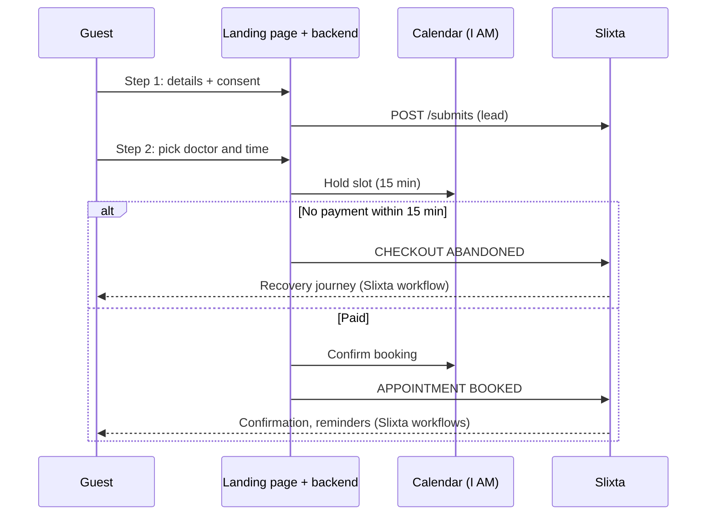

# Slixta CRM integration

_Last updated: 24 Nov 2026, after Slixta's summary email (Renzil). This replaces the earlier 16-endpoint request._

## How it works

Slixta is the CRM: the centre team and telecallers work there. The landing page sends Slixta what happened, and Slixta does everything after that through its own workflows: WhatsApp messages, reminders, checkout recovery, telecaller follow-up, reschedules and cancellations.

- **One way only.** We call Slixta. Slixta sends nothing back (no webhook).
- **Three calls**, all from our backend through the job queue (retried if Slixta is down).
- **No lead ID.** Slixta finds the lead by phone or email. A later call updates the lead's fields.
- **Centre routing** is by `_pageLink` (each centre's pages have their own URL). One `dataSourceId` for all centres.
- **Slixta is not a booking system.** It keeps the appointment time and service as fields on the lead. The booking itself lives in the calendar (I AM) and our database.



## The three calls

| When | Call | Code |
| --- | --- | --- |
| Guest submits step 1 of the booking form (also again if they add an email at step 2) | `POST /submits` | `sendLead` in [slixta-sync.ts](../packages/funnel/src/slixta-sync.ts) |
| The 15-minute hold ends without a payment | `POST /extinteractions`, `iType: "CHECKOUT ABANDONED"` | `sendCheckoutAbandoned` |
| Payment verified **and** the calendar confirmed the booking | `POST /extinteractions`, `iType: "APPOINTMENT BOOKED"` | `sendAppointmentBooked` |

If a guest abandons and pays later (through the resume link), they get both: CHECKOUT ABANDONED first, then APPOINTMENT BOOKED. Slixta's workflow stops the recovery when the booking arrives.

APPOINTMENT BOOKED is sent once per booking. If the calendar's answer is unknown at payment time, it is sent when the retry gets the confirmation. If the guest paid but the calendar did not book (the refund case), nothing is sent to Slixta; it stays a Payment Issue on our side, and the guest's page asks them to call reception.

## Request format (from Slixta)

Auth header: `X-Api-Key: <key>`. Each API has its own key. JSON in and out. `200 OK` means success. Dates are numbers in epoch milliseconds.

### Submit a Lead

`POST https://hook.slixta.com/submits`

```json
{
  "orgId": "<org id>",
  "dataSourceId": "<data source id>",
  "payload": {
    "name": "Asha Patel",
    "phone": "+919876543210",
    "email": "asha@example.com",
    "_pageLink": "https://<site>/ahmedabad/joints?utm_source=facebook&utm_campaign=ahm-joints-nov",
    "_bookingRef": "AHM-482913",
    "_centre": "Sri Sri Wellbeing Ahmedabad",
    "...": "custom fields below"
  }
}
```

### Add Interactions

`POST https://cdp.slixta.com/extinteractions?orgId=<org id>`

```json
{
  "items": [
    {
      "phone": "+919876543210",
      "iType": "APPOINTMENT BOOKED",
      "extpayload": {
        "_appointmentTime": 1795500000000,
        "_appointmentService": ["Consultation"],
        "_bookingRef": "AHM-482913",
        "_doctor": "Dr Asha Rao",
        "...": "custom fields below"
      },
      "agentEmail": "<optional Slixta staff email>",
      "interactionTs": 1795489200000
    }
  ]
}
```

We send only the phone on interactions (not the email), so a family that shares one email never gets matched to the wrong lead. Empty fields are left out, so a later call never blanks a field Slixta already has.

## Fields we send

Slixta creates the custom fields once the integration is live. All names start with `_`.

| Field | Lead | Abandoned | Booked | Example / source |
| --- | :-: | :-: | :-: | --- |
| `name`, `phone`, `email` | ✓ | phone | phone | Booker's details from step 1 |
| `_pageLink` | ✓ | | | Landing page with its ad parameters; routes the lead to the centre |
| `_bookingRef` | ✓ | ✓ | ✓ | `AHM-482913` (ours) |
| `_centre`, `_centreCode` | ✓ | ✓ | ✓ | `Sri Sri Wellbeing Ahmedabad`, `AHM` |
| `_programme`, `_concern` | ✓ | ✓ | ✓ / – | `Knees · Back · Joints`, `joints` |
| `_who`, `_patientName`, `_patientIsAdult` | ✓ | ✓ | ✓ | `My parent`, `Ramesh Patel`, `true` |
| `_language` | ✓ | ✓ | ✓ | `Gujarati` |
| `_doctor`, `_consultMode` | after step 2 | ✓ | ✓ | From the calendar: `Dr Asha Rao`, `offline` / `online` |
| `_amountInr` | ✓ | ✓ | ✓ | Doctor's fee locked at hold, e.g. `500` |
| `_resumeUrl` | ✓ | ✓ | ✓ | Personal link back to the booking form (7 days) |
| `_source`, `_utm_*`, `_fbclid`, `_gclid` | ✓ | | | Ad attribution |
| `_promotionalConsent` | ✓ | | | `true` / `false` |
| `_slotTime` | | ✓ | | Time the guest had held (epoch ms) |
| `_appointmentTime` | | | ✓ | Confirmed time from the calendar (epoch ms) |
| `_appointmentService` | | | ✓ | `["Consultation"]` (env `SLIXTA_APPOINTMENT_SERVICE`) |
| `_calendarBookingId` | | | ✓ | I AM booking ID |
| `_centreAddress` | | | centre visits | Centre address |
| `_bookingUrl` | | | ✓ | Booking details page (60 days) |
| `_paymentId` | | | ✓ | Razorpay payment ID |

## What Slixta does (not us)

- WhatsApp confirmation, reminders and checkout recovery (Slixta workflows on the two `iType`s)
- Telecaller follow-up, including no-shows and payment questions
- Reschedules and cancellations: the guest calls, the telecaller changes it in Slixta
- Nurture and campaigns
- AI calls come later and are not part of the landing page

## Setup

| Variable | Value |
| --- | --- |
| `SLIXTA_SUBMIT_API_KEY`, `SLIXTA_INTERACTIONS_API_KEY` | From Slixta (received 24 Nov): one key for `/submits`, one for `/extinteractions` |
| `SLIXTA_ORG_ID`, `SLIXTA_DATA_SOURCE_ID` | From Slixta. Until all four are set, the funnel runs in mock mode: calls are logged, nothing is sent |
| `SLIXTA_AGENT_EMAIL` | Optional |
| `SLIXTA_APPOINTMENT_SERVICE` | `Consultation` unless Slixta names it differently |
| `SLIXTA_SUBMIT_URL`, `SLIXTA_INTERACTIONS_URL` | Only to override `https://hook.slixta.com` / `https://cdp.slixta.com` |

`GET /api/health` shows `slixta: "http"` once all four are set.

## Still to confirm with Slixta

- [x] API keys (received 24 Nov)
- [x] `orgId` and `dataSourceId` (received 24 Nov)
- [ ] The exact name for `_appointmentService` (we send `["Consultation"]`)
- [ ] The `_pageLink` patterns that route to each centre (Ahmedabad: `https://<site>/ahmedabad/...`)
- [ ] Custom fields created in Slixta for the table above
- [ ] The abandoned-cart workflow details Slixta will share later
