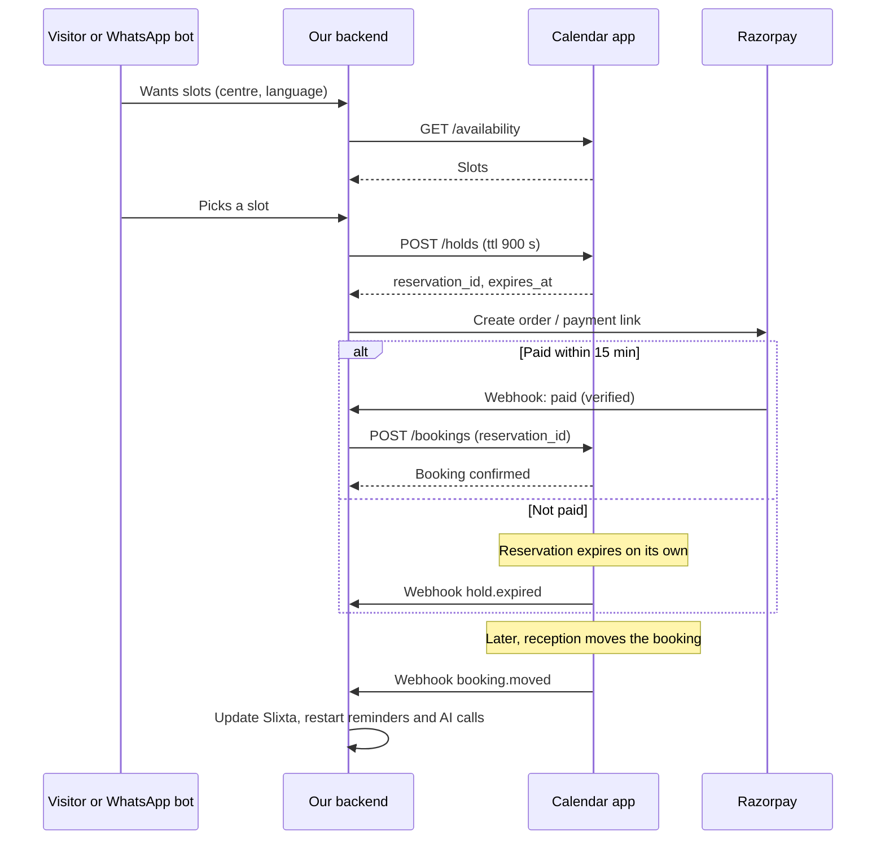

# Calendar Integration — Replacing Cal.com in the SSW Funnel

_Prepared for: our calendar team · Last updated: 13 Nov 2026_

## Summary

The Figma board (section 7) puts Cal.com on top of practitioners' Google Calendars. We are replacing Cal.com with our own calendar app. Our funnel backend needs it to:

- Give **live slots** to the landing page and to the WhatsApp AI bot
- **Hold** a slot for 15 minutes with a reservation ID, and release it on its own if unpaid
- **Confirm** a held slot into a booking when payment is verified
- Let **reception** add walk-ins and phone bookings, and move bookings within or between centres
- **Notify** our backend of every change, so Slixta, reminders and AI calls stay in sync

That is **8 endpoints and 1 webhook**. The calendar stays the only source of truth for slots.

## What the board requires (section 7)

| Board step | Calendar requirement |
| --- | --- |
| Each practitioner or room has a calendar, under its centre team | Resources (practitioner / room) grouped by centre |
| Availability = working hours minus busy events, with buffers and daily limits | Availability engine with working hours, busy blocks, buffer minutes, daily limit per resource |
| Live slots on the landing page and in the WhatsApp chat | Availability API, fast enough to call while a visitor waits |
| Hold for 15 min, reservation ID saved in the Ops DB | Hold API returning a reservation ID and expiry |
| Paid within 15 min → booking confirmed and written to the calendar | Confirm API; the booking shows on the practitioner's calendar |
| Not paid → reservation expires, slot is free again | Server-side expiry |
| Walk-ins and phone bookings added by reception in the same calendar | Reception UI blocks the slot; we get a webhook |
| Change request: reception moves the booking, same or another centre | Move across resources and centres; webhook to us |
| Calendar webhook → update Slixta, restart reminders and calls | Webhook on create / move / cancel / attendance |

## Flow



---

## Endpoints

| # | Method and path | Called when | Behaviour |
| --- | --- | --- | --- |
| 1 | `GET /v1/centres/{centre}/availability` | Landing page step 2 (prefetched), WhatsApp bot `get_slots` | Bookable slots per day, after hours, busy blocks, buffers, daily limits, holds and bookings |
| 2 | `POST /v1/holds` | Visitor or bot picks a slot | Atomic 15-min reservation. Returns `reservation_id`, `expires_at`. `409` if just taken |
| 3 | `DELETE /v1/holds/{reservation_id}` | Visitor changes slot; payment failed and recovery started | Release now |
| 4 | `POST /v1/holds/{reservation_id}/extend` | Razorpay Checkout opens with under 5 min left | One extension, up to 5 min |
| 5 | `POST /v1/bookings` | Payment verified | Convert a reservation into a booking. Works after expiry if the slot is still free; `409 slot_lost` otherwise |
| 6 | `GET /v1/bookings/{ref}` | Status page, reconciliation | Current booking |
| 7 | `GET /v1/bookings?centre=…&date=…` | Daily reconciliation | All bookings for a centre and day |
| 8 | `PATCH /v1/bookings/{ref}` | Payment Issue resolution (rebook to nearest free slot) | Move or cancel |
| W | Webhook → `POST https://<our-domain>/api/webhooks/calendar` | Any change in the calendar | Events below |

### 1. Availability

`GET /v1/centres/ahmedabad/availability?service=nadi-pariksha&from=2026-11-14&to=2026-11-20&language=Gujarati`

```json
{
  "centre": "ahmedabad",
  "service": "nadi-pariksha",
  "timezone": "Asia/Kolkata",
  "duration_minutes": 30,
  "days": [
    {
      "date": "2026-11-14",
      "slots": [
        { "slot_id": "s_8f2a", "start": "2026-11-14T09:30:00+05:30", "end": "2026-11-14T10:00:00+05:30", "resource_id": "dr_mehta", "languages": ["Gujarati", "Hindi"] },
        { "slot_id": "s_8f2b", "start": "2026-11-14T10:15:00+05:30", "end": "2026-11-14T10:45:00+05:30", "resource_id": "dr_shah", "languages": ["Gujarati", "English"] }
      ]
    },
    { "date": "2026-11-15", "slots": [] }
  ]
}
```

- `language` is optional and filters by practitioner languages.
- The visitor picks a time, not a doctor, so the calendar may merge equal times across practitioners. In that case return one slot per time and assign a practitioner at hold time.
- 30 minutes is a placeholder; the service configuration sets the real duration.

### 2. Hold

Headers: `Idempotency-Key: hold-AHM-482913-s_8f2b`

```json
{
  "slot_id": "s_8f2b",
  "ref": "AHM-482913",
  "ttl_seconds": 900,
  "channel": "web_form",
  "customer": { "name": "Asha Patel", "phone": "+919876543210", "language": "Gujarati" }
}
```

Response `201`:

```json
{ "reservation_id": "rsv_31c9", "slot_id": "s_8f2b", "resource_id": "dr_shah", "expires_at": "2026-11-14T10:20:00+05:30" }
```

`409 { "code": "slot_unavailable" }` if taken. A new hold for the same `ref` releases the previous one.

### 5. Confirm booking

Headers: `Idempotency-Key: booking-AHM-482913`

```json
{
  "reservation_id": "rsv_31c9",
  "ref": "AHM-482913",
  "customer": {
    "name": "Asha Patel",
    "phone": "+919876543210",
    "patient_name": "Ramesh Patel",
    "patient_is_adult": true,
    "language": "Gujarati"
  },
  "payment": { "provider": "razorpay", "payment_id": "pay_N8y...", "amount_inr": 500 }
}
```

| Case | Response |
| --- | --- |
| Reservation active | `201` booking confirmed |
| Reservation expired, slot still free | `201` booking confirmed |
| Reservation expired, slot gone | `409 { "code": "slot_lost" }` → we open a Payment Issue |
| Same ref again | `200` existing booking |

```json
{
  "ref": "AHM-482913",
  "status": "confirmed",
  "centre": "ahmedabad",
  "start": "2026-11-14T10:15:00+05:30",
  "end": "2026-11-14T10:45:00+05:30",
  "resource": { "id": "dr_shah", "name": "Dr. Shah", "type": "practitioner" }
}
```

### Webhook events

```json
{
  "id": "evt_9k2...",
  "type": "booking.moved",
  "occurred_at": "2026-11-13T16:40:00+05:30",
  "data": {
    "ref": "AHM-482913",
    "from": { "centre": "ahmedabad", "start": "2026-11-14T10:15:00+05:30" },
    "to": { "centre": "ahmedabad", "start": "2026-11-15T11:00:00+05:30", "resource_id": "dr_mehta" },
    "by": "reception"
  }
}
```

| Type | When | What our backend does |
| --- | --- | --- |
| `hold.expired` | Reservation passed its expiry unpaid | Start checkout recovery (if not already) |
| `booking.created` | Reception adds a walk-in or phone booking | Create or update the contact and appointment in Slixta, schedule reminders |
| `booking.moved` | Reception moves a booking (same or another centre) | Update Slixta, reassign owner if the centre changed, restart reminders and AI calls |
| `booking.cancelled` | Booking cancelled | Update Slixta, cancel reminders and calls |
| `booking.attended` | Marked attended (if the calendar tracks it) | Stage Visited |
| `booking.no_show` | Marked no-show (if the calendar tracks it) | No Show journey |

Headers: `X-Calendar-Signature: sha256=<HMAC-SHA256 of "{timestamp}.{raw body}">`, `X-Calendar-Timestamp`. Retry with backoff for at least 24 hours. Unique `id` per event.

For walk-in and phone bookings (`booking.created`), please include the customer's phone number so we can match the contact.

---

## Rules the calendar must enforce

| Rule | Detail |
| --- | --- |
| Atomic holds | Never two holds or bookings on the last capacity of a slot (row lock or conditional write) |
| Server-side expiry | Expired reservations free the slot on their own and fire `hold.expired` |
| Idempotency | Same `Idempotency-Key` returns the first result for 24 h |
| Time | ISO 8601 with `+05:30`; the calendar owns the timezone |
| Auth | API key per environment; HMAC-signed webhooks |
| Speed | Availability under 300 ms p95; holds under 500 ms p95 |

## Configuration owned by the calendar

- Centres and their resources (practitioners, rooms)
- Working hours per resource, holidays, busy blocks
- Buffer minutes between appointments, daily limit per resource
- Practitioner languages (and gender, if women-doctor preference is added)
- Service duration, minimum lead time, booking window (the mock-up shows the next 7 days, starting tomorrow)

## What we build ourselves

- "Add to calendar" `.ics` file and Google Calendar link for the customer
- Map links per centre
- The on-screen 15-minute countdown (display only, from `expires_at`)

## Open questions for the calendar team

- [ ] Does the calendar already sync with practitioners' Google Calendars (busy times in, bookings out), as the board's Cal.com setup did?
- [ ] Do server-side holds with expiry exist, or are they new work?
- [ ] Is capacity per practitioner (one guest per slot) or per centre?
- [ ] Can reception move bookings between centres in the calendar UI?
- [ ] Does the calendar record attended / no-show, or do staff do that in Slixta only?
- [ ] Staging environment and API keys; timeline for endpoints 1–5 (phase 1)
