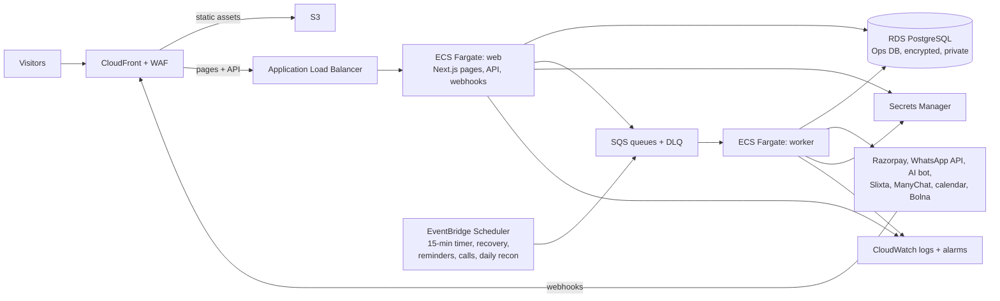

# Deployment Guide — Vercel Demo, then AWS Production

_Last updated: 13 Nov 2026_

The demo runs on Vercel. Production runs in the **client's AWS account, Mumbai region (`ap-south-1`)**, using the services proposed on the Figma board (section 14): CloudFront, ECS Fargate, RDS PostgreSQL, SQS with a dead-letter queue, EventBridge Scheduler, Secrets Manager and CloudWatch. The code is the same in both places; only the queue and timer adapters change.

## Production architecture

| Board item (section 14) | How we deploy it |
| --- | --- |
| Landing page: S3 + CloudFront | CloudFront in front of everything. Next.js static assets (`/_next/static`, images) go to S3; pre-rendered centre pages are cached at CloudFront. See the note below |
| Backend on ECS Fargate: API, webhook receiver, all funnel rules | Fargate service `web` (Next.js server: API routes + webhooks) and service `worker` (queue consumer), same Docker image |
| Ops DB: RDS PostgreSQL, encrypted, private | RDS PostgreSQL in private subnets, encryption at rest, Multi-AZ in production |
| Queues: SQS with retries and dead-letter queue | Queues per job type (Slixta sync, WhatsApp send, calls, payments), each with a DLQ |
| Timers: EventBridge Scheduler | One-time schedules for the 15-min payment timer, recovery steps, reminders and calls, all targeting SQS; a recurring schedule for daily reconciliation |
| Secrets Manager, CloudWatch | All API keys in Secrets Manager; logs, metrics and alarms in CloudWatch |

**Note on S3 for the landing page.** The board shows the landing page as a static site on S3. Our booking form calls server routes at every step, and Next.js already pre-renders the centre pages, so CloudFront serves them from cache just as fast. Keeping pages and API in one Next.js app means one build and one deploy. If a fully static landing on S3 is required, the pages can be exported separately and the API served from a subdomain; this costs a second deploy pipeline.

---

## Keep the code portable

- No Vercel-only services. Plain PostgreSQL via Drizzle; plain `fetch` to partners.
- `output: "standalone"` in `next.config.ts` for the Docker image.
- A `Queue` interface with two adapters: **SQS** (AWS) and **Postgres jobs table** (demo / local).
- A `Scheduler` interface with two adapters: **EventBridge Scheduler** (AWS) and **Postgres `schedules` table polled every minute** (demo / local).
- All secrets from environment variables.

---

## Part 1 — Vercel demo

1. Push the monorepo to GitHub and import `apps/web` into Vercel (root directory `apps/web`). `main` becomes the demo URL; every pull request gets a preview.
2. Add Postgres from the Vercel Marketplace (Neon). Set `DATABASE_URL`. Run `npm run db:migrate`.
3. Set environment variables with **test values only**: Slixta keys, org and data source IDs (or leave them empty for mock mode), calendar staging (or `CALENDAR_MODE=mock`), Razorpay test keys.
4. Set `QUEUE_DRIVER=postgres` and `SCHEDULER_DRIVER=postgres`.
5. **Background jobs.** Partner calls (Slixta, Meta) run straight after each form, hold or payment request, using Next's `after()` (`apps/web/lib/route.ts`). The 15-minute payment timer needs a call every minute: set `CRON_SECRET` in Vercel, then add a job on [cron-job.org](https://cron-job.org):
   - URL `https://<demo-domain>/api/cron/tick`, method `GET`, every minute
   - Header `Authorization: Bearer <CRON_SECRET>`
   - Notify on failure

   Vercel's own daily cron in `apps/web/vercel.json` stays as a backup (the free plan allows only daily crons). On AWS none of this is needed: SQS and EventBridge trigger the worker.
6. Register test webhooks to the demo domain: Razorpay (test mode), Slixta sandbox (including WhatsApp events), calendar staging; ManyChat and Bolna in phase 2.
7. Turn on Vercel Deployment Protection until launch.

---

## Part 2 — AWS production

### Setup steps

1. **Accounts.** Use the client's AWS account (separate `staging` and `production` accounts or environments). Access through IAM Identity Center with MFA. Region `ap-south-1`.
2. **Network.** VPC with public subnets (ALB, NAT) and private subnets (Fargate, RDS) across two availability zones.
3. **Ops DB.** RDS PostgreSQL in private subnets: encrypted (KMS), Multi-AZ, automated backups of 7+ days, deletion protection, security group open only to the Fargate services.
4. **Secrets.** Every key in Secrets Manager (list below), injected into the Fargate task definitions.
5. **Queues.** SQS standard queues: `slixta-sync`, `whatsapp-send`, `calls`, `payments`, `calendar`, each with a DLQ after 5 receives. FIFO only where ordering per contact matters (`slixta-sync`, message group = contact ID).
6. **Container image.** GitHub Actions builds one Docker image (Next.js standalone + worker entrypoint) and pushes it to ECR.
7. **Fargate services.**
   - `web`: at least 2 tasks across two AZs behind the ALB; health check `/api/health`.
   - `worker`: at least 1 task, scaling on queue depth.
   - Run `npm run db:migrate` as a one-off ECS task before each deploy.
8. **Timers.** Give the backend an IAM role that can create EventBridge Scheduler one-time schedules targeting SQS. Add a recurring schedule for daily reconciliation (for example 02:00 IST) and the weekly hygiene report.
9. **CloudFront + S3.** One distribution with origins S3 (`/_next/static/*`, images, long cache) and ALB (everything else; pages cached per their revalidate settings, `/api/*` never cached). ACM certificate in `us-east-1` for CloudFront. Route 53 alias for the domain.
10. **WAF** on CloudFront: rate-based rules on `/api/leads`, `/api/holds`, `/api/payments/*`; AWS managed common and bot rule groups. Webhook paths are allowed but must pass signature checks in the app.
11. **Monitoring.** CloudWatch alarms to the operations owner (SNS email / Slack):
    - Any message in a DLQ
    - Webhook 5xx rate
    - Paid without a confirmed booking after 5 minutes
    - Slixta error rate over 5% in 5 minutes
    - Reconciliation found gaps
    - RDS CPU over 80% or free storage under 20%
12. **Go live.** Switch partner keys to production, register production webhooks, lower DNS TTL a day ahead, switch DNS, make one real ₹500 booking end to end (form → payment → calendar → Slixta → WhatsApp receipt), then resolve it through the technical reversal process.

### CI/CD

| Branch | Deploys to | Checks |
| --- | --- | --- |
| Pull request | Vercel preview | Lint, type check, unit tests (Vitest), booking end-to-end tests (Playwright, mock adapters) |
| `staging` | AWS staging | Same + migrations |
| `main` | AWS production | Same + manual approval |

---

## Environment variables

| Variable | Used for |
| --- | --- |
| `DATABASE_URL` | Ops DB |
| `SITE_URL` | Canonical URLs, links in messages, webhook registration |
| `QUEUE_DRIVER` (`sqs` / `postgres`), `SQS_QUEUE_URL_*` | Queue adapter |
| `SCHEDULER_DRIVER` (`eventbridge` / `postgres`), `SCHEDULER_ROLE_ARN`, `SCHEDULER_TARGET_QUEUE_ARN` | Timer adapter |
| `SLIXTA_SUBMIT_API_KEY`, `SLIXTA_INTERACTIONS_API_KEY`, `SLIXTA_ORG_ID`, `SLIXTA_DATA_SOURCE_ID`, `SLIXTA_AGENT_EMAIL`, `SLIXTA_APPOINTMENT_SERVICE` | CRM (docs/02) |
| `CALENDAR_API_URL`, `CALENDAR_API_KEY`, `CALENDAR_WEBHOOK_SECRET` | Calendar |
| `RAZORPAY_KEY_ID`, `RAZORPAY_KEY_SECRET`, `RAZORPAY_WEBHOOK_SECRET`, `NEXT_PUBLIC_RAZORPAY_KEY_ID` | Payments |
| `AI_BOT_URL`, `AI_BOT_API_KEY`, `BOT_TOOLS_API_KEY` | Client's AI bot and the tools API it calls |
| `MANYCHAT_WEBHOOK_SECRET` | ManyChat External Request auth |
| `BOLNA_API_KEY`, `BOLNA_AGENT_ID`, `BOLNA_WEBHOOK_SECRET` | AI calls |
| `META_PIXEL_ID`, `META_CAPI_TOKEN`, `NEXT_PUBLIC_GA4_ID` | Tracking |
| `LINK_SIGNING_SECRET` | Signed personal booking / resume links |
| `CRON_SECRET` | Demo cron route |

## Cost

Estimate in the AWS Pricing Calculator once monthly leads and bookings are known. Fixed monthly costs: RDS (Multi-AZ), NAT gateway, ALB, WAF and at least 3 Fargate tasks. Variable: CloudFront traffic, SQS, EventBridge schedules, CloudWatch logs.
