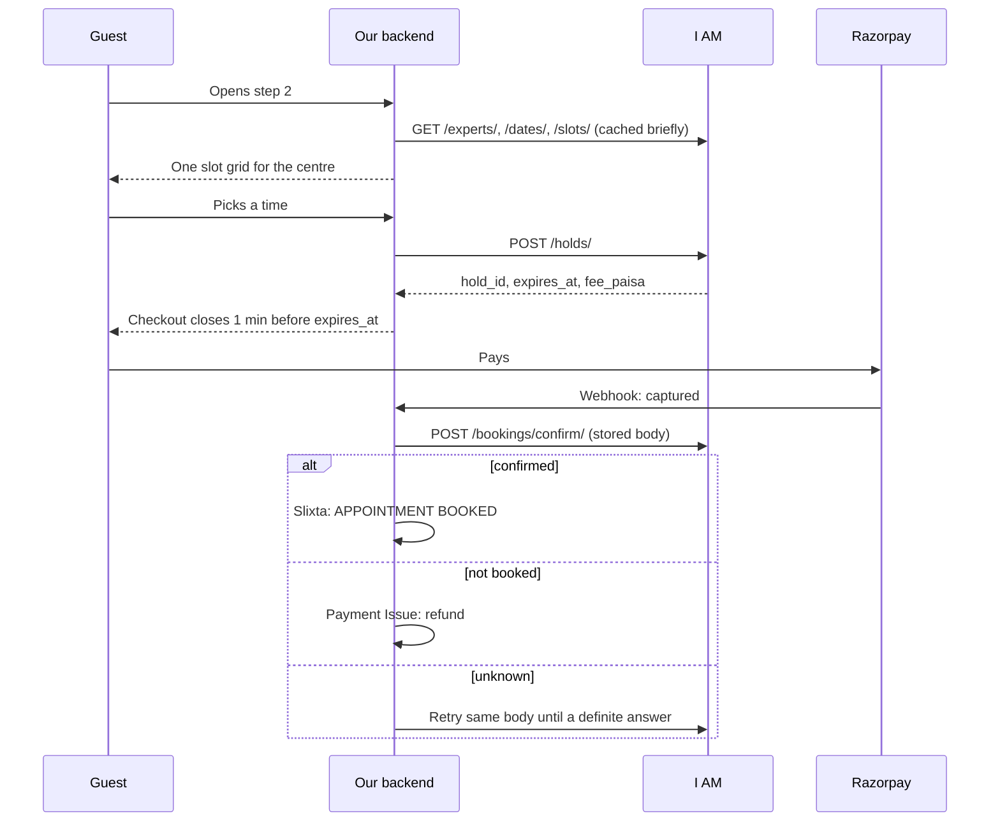

# I AM Partner Booking API in the SSW Funnel

_Prepared for: our team and operations · Last updated: 21 Nov 2026_
_Source: I AM Partner Booking API Integration Guide v1.1 (12 Nov 2026) and the Postman collection, both in this folder._

## Summary

I AM owns the doctors, their fees and their calendars. The guest picks a doctor from I AM's list, then a day and time. We **hold** the slot for 15 minutes while they pay that doctor's I AM fee on our Razorpay checkout, then **confirm** it. SSW keeps payments and refunds. Slixta sends every WhatsApp message (docs/02).

The funnel already talks to "a calendar" through one interface. I AM is now a third implementation next to the mock calendar and our own calendar app (docs/03).

**Decisions (21 Nov 2026):**

- **No phone OTP.** The guest pays before anything is booked, so an OTP step would only add friction. The guide's OTP note is knowingly not followed.
- **The guest pays the doctor's I AM fee**, exactly as I AM locks it at hold. There is no SSW discount, so `discount_paisa` is 0.
- **Everything about doctors comes from the API:** names, specialities, languages, experience, fee, modes and session lengths. Even the centre code is read from `GET /centres/` if not set. Nothing about doctors is hard-coded.
- **One key per centre.** Every Ahmedabad page uses the Ahmedabad key. Each new centre gets its own key, and its pages use it (see Keys).
- **Centre visits and online.** The live Ahmedabad doctors see guests at the centre, and the funnel offers whichever modes each doctor has. Staging only has online doctors, so testing uses online bookings until a centre-visit doctor is available.
- **Booking for a parent.** We send the parent's name with the booker's phone and email, so I AM creates the app account on the booker's email under the parent's name. SSW confirmed this is fine.

| Setting | Calendar used |
| --- | --- |
| `IAM_API_BASE_URL` and a centre key (`IAM_API_KEY_AHM`) set | I AM |
| `CALENDAR_API_URL` set | Our own calendar app (docs/03) |
| Nothing set | Mock calendar (local and demo) |
| `CALENDAR_MODE=iam` / `http` / `mock` | Forces one of the above |

`GET /api/health` shows `"calendar": "iam"` when it is live.

## The one rule

> If Confirm returns anything other than `result: "confirmed"`, the booking was **not** made and the guest is refunded.
> A 5xx, timeout or network error means the outcome is **unknown**: retry the same request, never refund.

| Confirm answer | What the funnel does |
| --- | --- |
| `201` confirmed, or `200` replayed | Booking saved, Slixta told `APPOINTMENT BOOKED` (it sends the receipt and reminders) |
| `409` `SLOT_UNAVAILABLE`, `HOLD_EXPIRED` | Appointment becomes **Payment Issue** `paid_not_booked`, refund required, telecaller task created |
| `409` `PARTNER_BOOKING_ID_CONFLICT`, `HOLD_ALREADY_CONFIRMED`, `400` `VALIDATION_ERROR`, `PHONE_MISMATCH`, `EMAIL_MISMATCH` | Same as above, plus an `[ALERT]` because it means a bug on our side (`ourBug: true` on the issue) |
| `5xx`, timeout, network error, `429 THROTTLED` | Payment kept, guest sees "We're still confirming your payment", **no receipt yet**. The same request is retried after 5 s, 15 s, 1 min, then every 5 min for about a week. An `[ALERT]` fires after the 6th attempt |

The exact request body is stored before the first send, so every retry is byte-for-byte the same and I AM replays instead of booking twice.



## How the funnel uses I AM

**Doctors and slots.** Step 2 of the booking card lists I AM's doctors for the centre. Each shows name, fee, speciality, years of experience, languages, and whether they see guests at the centre, online, or both. Doctors who speak the guest's chosen language come first. I AM's languages are free text ("eng", "hindi"), so we normalise them. The guest picks a doctor, then a mode if the doctor offers both, then a day and time. Only `available: true` slots are shown, and `start` is passed back to I AM unchanged. Days start today, because I AM applies its own 2-hour minimum notice. Centre visits use 30 minutes if the doctor offers it, else the doctor's shortest length. Online length is fixed by I AM.

**Holds are never released while a payment may still arrive.** Once a Razorpay order exists for a booking, we don't call `/release/`, even when the timer ends or the guest changes the time. The hold expires by itself, so a late UPI payment can still confirm (`late_confirmation: true`) when the slot is still free. A new hold from the same phone replaces the old one at I AM. We only release when the guest leaves before opening checkout.

**No extensions.** I AM holds can't be extended, so the one-time 5-minute extension used with our own calendar is skipped.

**Price.** Each doctor card and the pay button show the doctor's I AM fee. The Razorpay order is for the fee I AM locks at hold, and the confirm reports `amount_paid_paisa` = `iam_fee_paisa` with `discount_paisa` 0. The landing page no longer names an amount, because fees differ per doctor (₹17 to ₹500 on staging). The hero, sticky bar, bullets, meta descriptions, refund text and the terms consent (now version `web-2026-11-v2`) all say "the consultation fee" instead. The mock calendar still charges the centre's `feeInr`.

**Moves and cancellations.** Reminders, reschedules and cancellations are Slixta's (the telecaller changes the booking; Slixta sends the messages). We no longer read the booking before reminders, because we no longer send them. I AM sends no webhook when its admin moves or cancels a booking, so Slixta's team needs to keep I AM and Slixta in step.

**What we send I AM about the guest.** The person the consultation is for, as first and last name. The booker's phone, which must match the hold. The booker's email, when given. A short note for the doctor, such as "Nadi Pariksha: Knees · Back · Joints. Booked by Asha Patel for their parent. Prefers Gujarati". For centre visits the email is optional: if I AM says that email's account is closed, we hold again without it.

## Keys

There is one key per centre, issued by I AM. Every landing page of that centre (`ahmedabad/joints`, `ahmedabad/sleep`, …) uses it:

```
IAM_API_KEY_AHM          every Ahmedabad page
IAM_API_KEY_<CODE>       each further centre, by its three-letter code
```

There is no shared fallback key. A centre without its own key can't book, rather than booking through another centre's key and putting the guest at the wrong centre. Each key sees only its own I AM centre, so the centre code is found from `GET /centres/` without configuration.

Each hold records which key made it (a fingerprint, never the key). Release, confirm and status for that hold use the same key.

**Rotation:** set the variable to `new_key,old_key`. New holds use the new key, and in-flight ones keep the old key. Remove the old key after a day, so late payments can still confirm, then ask I AM to disable it.

Keys are server-side secrets only. They are never sent to the browser and never logged.

**Adding a centre.** The pages are the Ahmedabad pages with the centre's own details. Nothing in the booking code changes:

1. Add the centre to `centres` in `packages/content/src/index.ts`: slug, three-letter code, address, hours, phones, map, languages, and `iam: { modes, expertType: "doctor", preferredDurationMinutes: 30 }`.
2. List its programmes in `centreProgrammes`. The pages `/<centre>/<programme>` are built from that.
3. Set `IAM_API_KEY_<CODE>` from the key I AM issues for that centre (Secrets Manager in production).
4. Make one staging booking on one of its pages.

## When a guest paid but was not booked (operations)

1. A Payment Issue of type `paid_not_booked` appears in the Ops DB with an `[ALERT]` in the logs. Nothing is sent to Slixta (it only hears about confirmed bookings). Automation for the contact is paused. The guest's page says "We couldn't confirm your payment in time" and asks them to call reception.
2. Refund the full amount in the Razorpay dashboard. **Refunds are manual today**: nothing in the funnel calls Razorpay's refund API.
3. Call or message the guest and offer a new time.
4. When the issue detail says `ourBug: true`, send engineering the `ref` and `partner_booking_id`.

For I AM support (Sahil Salaria), send the endpoint, the time, the `hold_id` or `partner_booking_id`, and the full response. Everything is in the `iam_bookings` table: `confirm_request_body`, `confirm_error_code`, `confirm_error_reason`, `confirm_last_response`. **Never send the API key.**

```sql
-- Bookings that need a refund
select appointment_ref, partner_booking_id, hold_id, confirm_error_code, confirm_error_reason, amount_paid_paise, payment_reference
from iam_bookings where refund_state = 'required';

-- After refunding in Razorpay
update iam_bookings set refund_state = 'done' where partner_booking_id = '…';
```

## Online consultations

Ahmedabad offers both modes (`iam.modes` in `packages/content`). The live doctors see guests at the centre. On staging all four Ahmedabad doctors are online-only, so testing uses online bookings for now. Centre visits are covered by the fake-I AM tests and need one staging check once a centre-visit doctor is available. For an online booking:

- Email is required at hold and confirm, and must match. If the guest skipped email in step 1, step 2 asks for it ("Email for the I AM app") before holding.
- The length is fixed by I AM (20 minutes today). We don't send `duration_minutes`.
- The booking card, booking page and calendar file say "Online video call" and show no map.
- APPOINTMENT BOOKED carries `_consultMode: "online"` and no centre address. Slixta's confirmation for online bookings should explain how to join, for example:

> Your online consultation with {{doctor}} is on {{date}} at {{time}}. Download the I AM app and sign in with the email you booked with, using Continue with Google, Sign up, or Forgot password. Your consultation will be waiting in your sessions. Join from there a few minutes before the start.

## Staging results (21 Nov 2026, SSW Ahmedabad key)

- `GET /centres/` returns one centre, `ssw_ahmedabad`, with the same address as our page.
- 4 doctors, all **online only**, with fees ₹17, ₹23, ₹50 and ₹500. Languages are free text, and one doctor has none.
- The guide checklist passes: hold, slot taken, confirm (201), replay (200, `replayed`), status by both IDs, release refused once confirmed, release twice, released → `HOLD_EXPIRED`, auto-replaced hold, invalid phone, phone mismatch, `PARTNER_BOOKING_ID_CONFLICT`, online email required, `EMAIL_MISMATCH`, online confirm with `session_booking_id`. The 16-minute late-confirmation check was not run.
- A full guest booking through the funnel, and through the booking card in Chrome (phone and desktop), confirms at I AM.
- I AM keeps a gap after a booking: the next slot can show as free but be refused with `SLOT_UNAVAILABLE`. The guest sees "that time was just taken" and picks again.
- A confirm took 9.8 s once (usually 0.3–0.4 s). Our timeout is 15 s, and a slower answer is retried safely.

**Local network note:** on the development machine, DNS lookups for IPv6 addresses time out (15–22 s) while IPv4 answers in milliseconds. Every I AM call then stalls or fails, which is a property of that router, not I AM. AWS is unaffected. Locally, start the dev server with `NODE_OPTIONS="--require ./scripts/ipv4-dns.cjs" npm run dev`.

## Rate limit

I AM allows 120 requests a minute per key. Choosing a doctor costs 1 + D calls (D = days with free slots, up to 8), and the doctor list is one call. Short caches keep us under the limit: doctors 5 minutes, dates 60 s, slots 20 s. Tune them with `IAM_CACHE_*`. A brief `429 THROTTLED` is retried automatically. `429 TOO_MANY_HOLDS`, more than 10 holds an hour from one phone, is never retried: the guest is asked to wait or call reception.

## Code

| Where | What |
| --- | --- |
| `packages/integrations/src/iam/api.ts` | Typed HTTP client for all 8 endpoints, error codes, throttling |
| `packages/integrations/src/iam/confirm.ts` | The one rule: `CONFIRMED` / `NOT_BOOKED` / `UNKNOWN` |
| `packages/integrations/src/iam/calendar.ts` | The calendar adapter used by the funnel |
| `packages/integrations/src/iam/keys.ts` | Keys per centre, rotation |
| `packages/db/src/schema.ts` → `iam_bookings` | One row per hold, through confirm and refund |
| `packages/funnel/src/booking.ts` | Release rule, price, confirm retry, refund issue |

## Tests

```bash
npm test     # unit tests + full funnel scenarios against a fake I AM (no network)
IAM_API_KEY_AHM=iam_test_… npx vitest run packages/integrations/src/iam/iam.staging.test.ts   # guide checklist
IAM_API_KEY_AHM=iam_test_… npx vitest run packages/funnel/src/iam.staging.test.ts          # one full guest booking
E2E_IAM=1 E2E_BASE_URL=http://localhost:3000 npm run test:e2e                                  # booking card in Chrome, server in I AM mode
```

The staging suites are skipped without a key and refuse to run with a live key or the production URL. They use whichever mode staging's doctors offer. Online holds use `IAM_TEST_EMAIL`, or a generated `@example.com` address if it isn't set; use a real inbox to also sign in to the I AM app (checklist 5, manual). `IAM_STAGING_SLOW=1` adds the 16-minute late-confirmation check. They create real bookings on I AM staging.

## Open questions

Marked `TODO(iam)` in the code. Answered on 21 Nov: keys are per centre, live doctors offer centre visits, and the parent account arrangement is fine (see Decisions).

| # | Question | For | Why it matters |
| --- | --- | --- | --- |
| 1 | A webhook when I AM admin moves or cancels a booking | I AM | Nobody hears about it today; Slixta would need it to message the guest |
| 2 | One open hold per phone: a guest booking for themselves and a parent at the same time loses the first hold | I AM | Rare. Worth knowing for support |
| 3 | A `401`/`403` on Confirm is treated as "not booked" (per the one rule). Should we instead fix the key and confirm again? | I AM | Avoids refunding when only our key was wrong |
| 4 | Any format or length limit on `partner_booking_id`? Ours look like `AHM-482913-6f1b8f3a2f3e`. Staging accepted them | I AM | Validation |
| 5 | Does `429` include `Retry-After`? | I AM | We honour it if present, else wait 2–4 s |
| 6 | A staging doctor who takes centre visits, to test that path once against I AM | I AM | Centre visits are only tested against our fake today |
| 7 | Automate refunds through Razorpay's API, or keep them manual? | SSW | Manual today |
| 8 | Slixta's confirmation and reminder for online bookings (how to join in the I AM app) | Slixta / SSW | Needed before online bookings go live |

## Going live

1. Tell I AM which centres launch (Ahmedabad first).
2. Staging checks: done on 21 Nov (see Staging results). Repeat one full booking on the Vercel demo with `IAM_API_BASE_URL` pointing at staging.
3. Slixta's workflows for online bookings are ready (joining instructions, no address).
4. I AM issues the live key for each centre through a secure channel. Put it in AWS Secrets Manager (docs/04) as `IAM_API_KEY_<CODE>`.
5. Switch the base URL to `https://api.iamlife.guru/api/v1/partner` and the keys to the live ones. This is configuration only, no code change.
6. Make one real booking per centre, at the centre and online, and check it with `GET /bookings/{partner_booking_id}/`.
